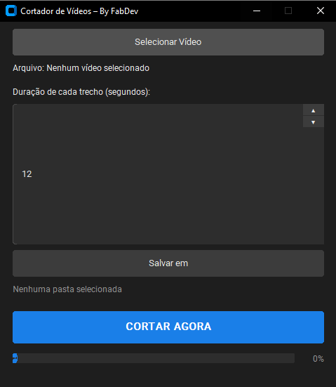

Projeto Cortador de Vídeos – Desktop App

[](https://www.python.org/)
[](https://customtkinter.tomschimansky.com/)
[](https://ffmpeg.org/)
[](LICENSE)

Uma aplicação desktop moderna, leve e de alta velocidade projetada para fatiar e dividir vídeos em partes menores com duração personalizada, **sem perda de qualidade** e com processamento quase instantâneo.

---

## Capturas de Tela

<div align="center">
  
  <p><em>Interface moderna com tema Dark Mode desenvolvida em CustomTkinter</em></p>
</div>

---

## Para Quem É Esse Projeto?

Este projeto foi desenvolvido especialmente para:

- **Criadores de Conteúdo & Social Media:** Para fatiar vídeos longos em partes perfeitas para **WhatsApp Status (30s)**, **Instagram Stories (15s ou 60s)**, **TikTok** e **YouTube Shorts**.
- **Profissionais de Marketing e Designers:** Que necessitam fragmentar depoimentos, gravações ou campanhas rapidamente sem complicações.
- **Educadores, Professores e Alunos:** Para dividir videoaulas, palestras e tutoriais em tópicos ou capítulos menores.
- **Usuários em Geral:** Qualquer pessoa que queira cortar um vídeo longo sem precisar instalar suítes de edição pesadas (como Premiere, DaVinci Resolve ou Sony Vegas) ou lidar com comandos complexos de terminal.

---

## O Que o Sistema Faz?

O **Cortador de Vídeos** recebe qualquer arquivo de vídeo suportado, calcula a sua duração total e o divide em blocos uniformes com base na quantidade de segundos estipulada pelo usuário.

### Por que ele é tão rápido?
Diferente de editores tradicionais que re-codificam o vídeo inteiro (processo demorado e que consome muita CPU/GPU), o sistema utiliza a tecnologia de **Stream Copy (`-c copy`) do FFmpeg**:
- **Velocidade Ultrarrápida:** Os segmentos são gerados à velocidade de leitura e gravação do disco (poucos segundos para vídeos longos).
- **100% Sem Perda de Qualidade:** O fluxo de vídeo e áudio original é preservado bit a bit, sem compressão adicional ou alteração de taxa de bits (bitrate).

---

##  Funcionalidades

- [x] **Seleção Simples de Arquivo:** Interface intuitiva para escolher o arquivo de vídeo original.
- [x] **Suporte a Múltiplos Formatos:** Compatível com `.mp4`, `.avi`, `.mov`, `.mkv`, `.wmv`, `.flv`, `.webm`, entre outros.
- [x] **Duração Ajustável por Trecho:** Controle interativo com botões de incremento/decremento (▲ / ▼) e digitação manual da duração em segundos.
- [x] **Escolha da Pasta de Saída:** Liberdade para direcionar os cortes para o diretório de sua preferência.
- [x] **Organização Automática de Nomes:** Gera arquivos organizados e ordenados (`parte_001.mp4`, `parte_002.mp4`, etc.).
- [x] **Barra de Progresso em Tempo Real:** Acompanhamento visual da porcentagem concluída e do status da parte atual sendo fatiada.
- [x] **Operação Não-Bloqueante (Multithreading):** A interface nunca congela ou exibe tela branca durante a execução dos cortes.
- [x] **Interface Gráfica Moderna (Dark Mode):** Visual limpo, responsivo e confortável aos olhos com CustomTkinter.

---

##  Stack Tecnológica

| Tecnologia | Finalidade |
| :--- | :--- |
| **[Python 3](https://www.python.org/)** | Linguagem base de desenvolvimento do projeto. |
| **[CustomTkinter](https://customtkinter.tomschimansky.com/)** | Construção da interface gráfica (GUI) moderna com tema escuro nativo. |
| **[MoviePy](https://zulko.github.io/moviepy/)** | Inspeção e extração precisa da duração e metadados do vídeo. |
| **[FFmpeg](https://ffmpeg.org/) / [imageio-ffmpeg](https://github.com/imageio/imageio-ffmpeg)** | Motor de alta performance para fatiamento direto em linha de comando (`-c copy`). |
| **Tkinter / Threading / Subprocess** | Bibliotecas padrão para gerenciamento de janelas, caixas de diálogo e execução paralela em background. |

---

##  Estrutura do Projeto

```text
Cortador-de-video/
│
├── Preview/
│   └── Screenshot_2.png   # Imagem de demonstração da interface gráfica
│
├── main.py                # Ponto de entrada da aplicação (Interface + Lógica de fatiamento)
├── requirements.txt       # Lista de dependências Python necessárias
└── README.md              # Documentação oficial do projeto
```

---

##  Como Instalar e Executar

### 1. Pré-requisitos

Certifique-se de ter o **Python 3.8 ou superior** instalado em sua máquina. Durante a instalação do Python, marque a opção **"Add Python to PATH"**.

Para verificar se o Python e o PIP estão instalados corretamente:
```bash
python --version
pip --version
```

### 2. Clonar o Repositório

Clone o repositório ou baixe os arquivos em formato ZIP:
```bash
git clone https://github.com/Fabdev1/Cortador-de-video.git
cd Cortador-de-video
```

### 3. Criar e Ativar um Ambiente Virtual (Recomendado)

- **No Windows (PowerShell):**
  ```powershell
  python -m venv venv
  .\venv\Scripts\Activate.ps1
  ```

- **No Windows (Prompt de Comando / CMD):**
  ```cmd
  python -m venv venv
  venv\Scripts\activate.bat
  ```

- **No Linux / macOS:**
  ```bash
  python3 -m venv venv
  source venv/bin/activate
  ```

### 4. Instalar as Dependências

Com o ambiente ativado, instale os pacotes listados no `requirements.txt`:
```bash
pip install -r requirements.txt
```

> **Nota sobre o FFmpeg:** O pacote `imageio-ffmpeg` (instalado automaticamente via `moviepy`) já fornece os binários necessários do FFmpeg, dispensando qualquer instalação manual externa no sistema!

### 5. Executar a Aplicação

Inicie o programa executando:
```bash
python main.py
```

---

##  Como Usar Passo a Passo

1. **Selecione o Vídeo:** Clique no botão **"Selecionar Vídeo"** e escolha o arquivo que deseja cortar no seu computador.
2. **Defina a Duração:** No campo **"Duração de cada trecho (segundos)"**, ajuste o valor desejado usando as setas ou digitando diretamente (ex: `30` para status do WhatsApp, `60` para Reels).
3. **Defina a Pasta de Saída:** Clique no botão **"Salvar em"** e selecione a pasta onde os vídeos cortados deverão ser salvos.
4. **Corte o Vídeo:** Clique no botão azul **"CORTAR AGORA"**.
5. **Acompanhe:** A barra de progresso indicará a porcentagem e o trecho que está sendo processado. Ao finalizar, uma mensagem de sucesso será exibida informando o total de partes salvas!

---

##  Dicas de Uso

- **Status do WhatsApp:** Defina a duração para `30` segundos.
- **Stories do Instagram:** Defina a duração para `15` ou `60` segundos.
- **Armazenamento:** Certifique-se de que a unidade onde os arquivos serão salvos tenha espaço em disco suficiente (o tamanho total somado das partes será equivalente ao do vídeo original).

---

## Desenvolvedor

Desenvolvido por **FabDev**.

Sinta-se à vontade para enviar sugestões, reportar problemas ou abrir Pull Requests para contribuir com novas funcionalidades!

